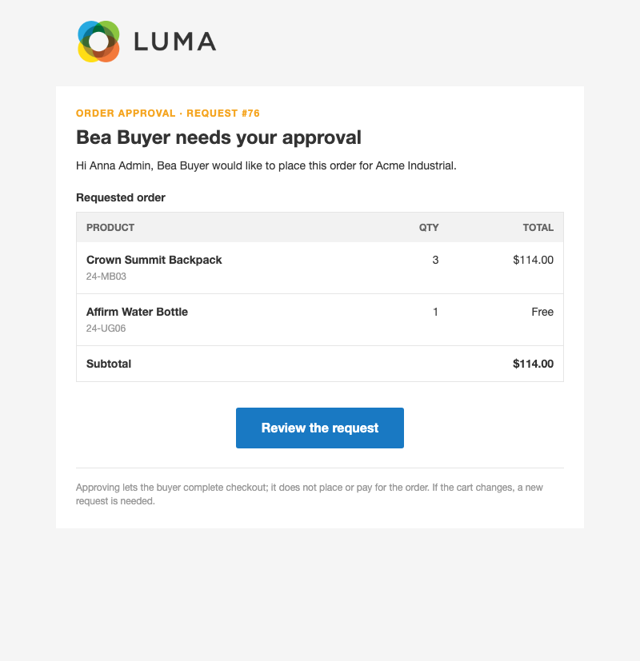
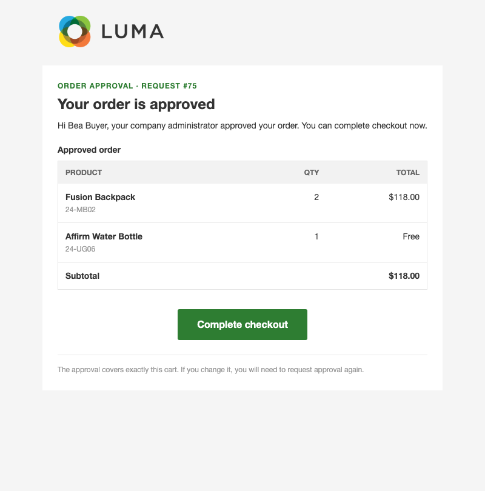
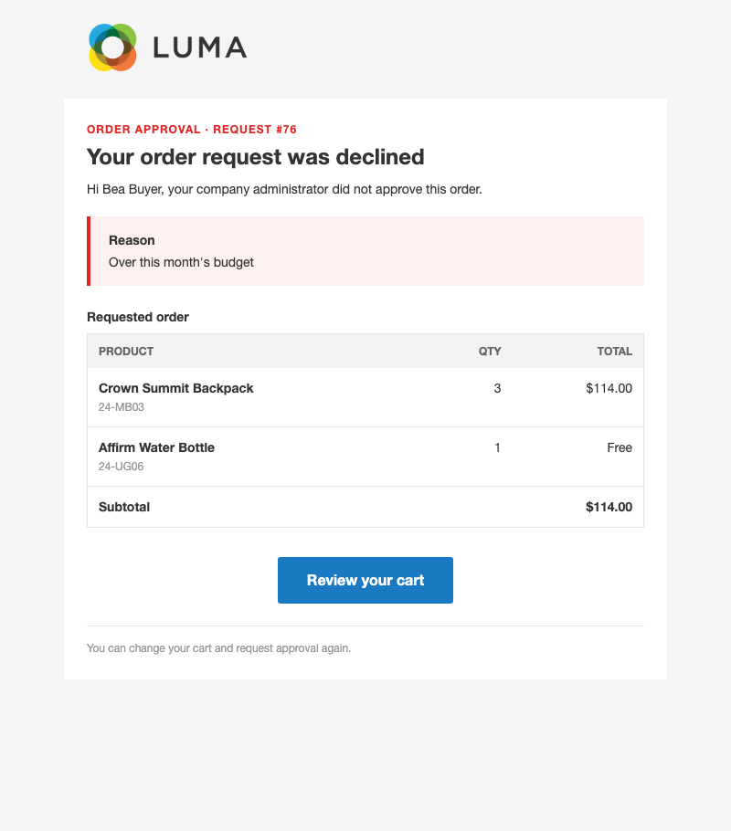

# B2B Order Approval for Magento 2

Let company administrators sign off on large orders before their buyers check out.

Purchase approvals are part of Adobe Commerce B2B; Magento Open Source has no way to stop a company buyer from
placing an order on their own. This module adds a simple approval step for company accounts created with
Tonyapps B2B: above a subtotal you choose, a buyer sends the cart to their company administrator, and checkout
opens only once the administrator has approved that exact cart.

## Features

- **Approval above a threshold you set** — choose the minimum cart subtotal per website, or require approval for
  every order placed by a company member.
- **One-click request from the cart** — the buyer asks for approval on the cart page; no extra forms.
- **Review queue in My Account** — the company administrator sees each request with the buyer, the cart lines and
  the subtotal, and approves or rejects it, with an optional reason.
- **Approval matches the cart** — an approval covers exactly the products, options, coupon and subtotal that were
  requested. If the cart changes afterwards, the approval is withdrawn and a new request is needed.
- **Every checkout path is covered** — the regular checkout, express payment buttons such as PayPal Express, and
  multi-address checkout all respect the approval.
- **Clear emails** — the administrator is emailed when a request arrives; the buyer is emailed when it is approved
  or declined. Each email lists the cart items with their totals.
- **Administrators are never blocked** — the company administrator places orders without asking for approval.

## How it works

1. A company member fills the cart. If the subtotal reaches the threshold, the cart page shows **Request Order Approval**
   instead of letting them proceed to checkout.
2. The company administrator gets an email and opens **My Account › Order Approval Requests**.
3. The administrator approves or rejects. The buyer gets an email either way.
4. After approval, the buyer goes back to the cart and checks out as usual, choosing payment and shipping then.
   Approval does not place the order or charge anything.

Orders created by store staff in the Magento admin are not affected.

## Screenshots

Emails as sent (Luma theme, 2026-11-09). Source images are in `docs/emails/`.

**Approval request (to the company administrator)**



**Order approved (to the buyer)**



**Order request declined (to the buyer)**



## Good to know

- Only the company administrator can approve or reject. Approver roles and multi-level approval chains are not
  included.
- The threshold is set in the website's base currency.
- Approval happens before checkout, not after the order is placed: there is no purchase-order status in the
  Magento admin.
- Requires the Tonyapps B2B module; the feature applies only to customers who belong to an active company.

## Requirements

- Magento Open Source 2.4 (developed on 2.4.8-p4)
- PHP 8.3 or 8.4
- `tonyapps/module-b2b`

## Installation

```bash
composer require tonyapps/module-b2b-order-approval
bin/magento setup:upgrade
```

Then enable the feature and set the minimum subtotal (see below).

## Configuration

- **Stores › Configuration › Tonyapps › B2B Order Approval › General** — enable per website and set the minimum
  base subtotal that requires approval (`0` = every order by a company member).
- **Stores › Configuration › Tonyapps › B2B Order Approval › Emails** — choose the request, approved and rejected
  email templates.

### Redesigning the emails

Pick any template made in **Marketing › Email Templates**, or a design made with the
[Email Designer](https://github.com/tonyappsorg/magento2-email-designer) (**Marketing › Communications › Email
Designer**), in the Emails settings above (default and website scope). The built-in template is used until you pick
another one. A new design starts from a ready-made copy of the module's email, with the order table and the
rejection reason as drag-and-drop blocks.

## For developers

Architecture, decisions, data model and tests are in [AGENTS.md](AGENTS.md).
